# Singularity 架构图谱

本文说明当前模块关系、状态归属、执行与恢复流程，并提供源码和改动影响入口。图中英文名对应源码对象；实线表示调用、传递或拥有，虚线表示引用或派生，具体关系以箭头文字为准。产品使用边界由[宪章](constitution.md)维护，控件行为见[工作台交互](desktop-ui.md)，运行命令见[开发指南](development.md)。

## 导航

| 要回答的问题 | 入口 |
| --- | --- |
| 程序由哪些部分组成，依赖方向和状态归属是什么？ | [系统总览](#system)、[模块职责](#modules)、[对象与所有权](#ownership)、[数据位置](#storage) |
| 正文、轨迹、草稿从哪里来，刷新怎样恢复？ | [前端视图](#frontend)、[协议与同步](#sync) |
| 发送、引导、停止怎样到模型、工具和最终结果？ | [执行主链](#execution)、[Agent 循环](#agent)、[执行窗口](#controls)、[收尾](#cancellation) |
| 模型设置、协议、重试和用量怎样串起来？ | [模型配置](#models)、[模型请求](#provider)、[请求观测](#requests) |
| 模型看到哪些指令、上下文和工具，长任务怎样压缩？ | [指令与技能](#instructions)、[上下文](#context)、[工具与图片](#tools) |
| 重启后怎样继续，改动影响怎样定位？ | [历史与恢复](#recovery)、[构建与入口](#delivery)、[影响导航](#impact) |

## 1. 系统总览

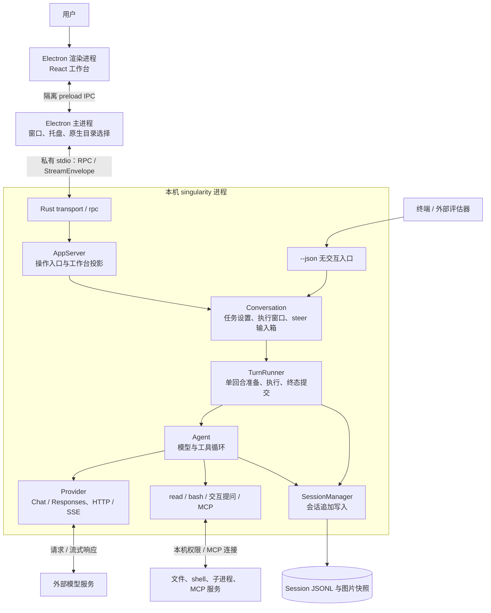

同一数据目录只运行一个程序，进程内可并行执行多个任务。项目登记组织上下文与任务列表；文件和命令仍继承本机进程权限。工作台使用本地 production 资源与私有管道，不监听 HTTP / WebSocket 端口。

源码：[程序入口](../crates/app/src/main.rs) · [传输](../crates/app/src/desktop/transport.rs) · [AppServer](../crates/app/src/desktop/app_server.rs) · [JSONL 入口](../crates/app/src/jsonl_mode.rs)。

## 2. 源码依赖与模块职责

下图画内部 crate 的直接生产依赖，箭头从使用方指向被使用方。

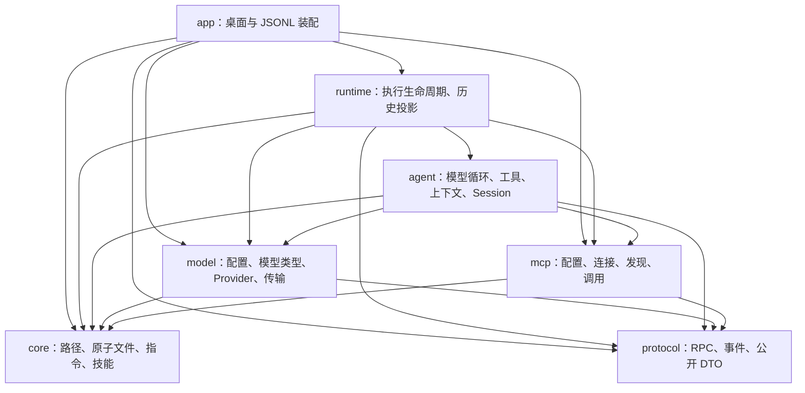

| 边界 | 主要维护入口 |
| --- | --- |
| 应用装配与操作 | `app/session_options.rs` 准备共享配置、Runner 和 MCP；`app/desktop` 提供传输、RPC、AppServer 与项目登记。 |
| 跨回合协调 | `runtime/conversation.rs` 及子模块维护设置、写者窗口、输入箱与执行预订。 |
| 单次操作 | `runtime/runner.rs` 提交回合终态，`runner/compaction.rs` 执行独立压缩，`assistant_items.rs` 投影公开事件。 |
| Agent 执行 | `agent/agent/mod.rs` 维护循环；`request.rs` 装配请求；`compaction.rs` 编排缩减；`dispatch.rs` 准入工具并提交结果。 |
| 会话与历史 | `agent/session` 维护日志与模型视图；`runtime/history.rs` 维护回合索引和公开历史；`thread_catalog.rs` 读取目录、分页与归档。 |

`core` 与 `protocol` 不依赖其他内部 crate。模型消息、会话条目和公开 DTO 在各自边界转换；前端通过生成的协议声明通信，不导入 Rust 内部实现。

源码：[Cargo workspace](../Cargo.toml) · [Runtime 导出](../crates/runtime/src/lib.rs) · [Agent 导出](../crates/agent/src/lib.rs) · [Model 导出](../crates/model/src/lib.rs) · [前端依赖](../apps/desktop/package.json)。

## 3. 对象、身份与状态所有权

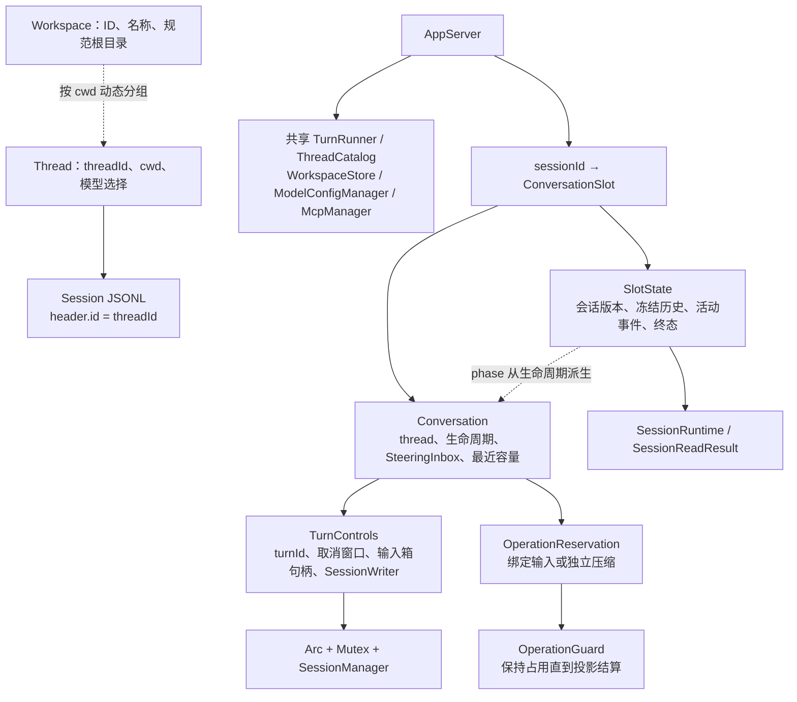

一个任务同一时刻只执行一个普通回合或独立压缩；一次预订只执行一个回合。普通回合有独立 `turnId`，包含一到多个模型步；每次请求尝试有独立 `requestId`，回复条目另有身份。独立压缩有自己的 operation，事件不绑定普通 turn。

公开工具身份由 assistant 条目 ID 与调用位置派生，用于实时和历史展示；模型协议配对使用提供方原始 tool call ID。用户输入在接受时分配固定消息身份，支持保存失败后继续交付。

`Conversation` 拥有 steer 输入箱，活动 `TurnControls` 借用它。`OperationReservation.execute` 消费预订并返回操作结果与守卫；调用方完成投影结算后释放守卫。`last_context_window` 只在回合准备成功时更新，运行中设置修改不改变本轮容量。写者只在读取或追加时短暂加锁，模型等待与工具执行不持锁。

AppServer 的生命周期临界区覆盖 slot 查找或创建、预订、归档与项目移除，保护启动和销毁的交接；全局帧序号、完整工作台快照发布和单会话投影分别由对应锁维护。

源码：[Conversation / 预订](../crates/runtime/src/conversation.rs) · [TurnControls / 生命周期](../crates/runtime/src/conversation/state.rs) · [SlotState](../crates/app/src/desktop/app_server/session.rs) · [SessionWriter](../crates/agent/src/session/mod.rs)。

## 4. 数据位置与维护边界

数据根为显式 `SINGULARITY_HOME`，或默认用户主目录下的 `.singularity`。

| 数据位置 | 唯一维护方与消费方式 |
| --- | --- |
| `workspaces.json` | `WorkspaceStore` 串行读改写；任务按持久 cwd 动态归组。`CanonicalWorkspacePath` 维护路径身份。 |
| `config.json` / `auth.json` | `ModelConfigManager` 维护配置和凭据，生成执行快照与脱敏目录；前端只写新密钥。 |
| `mcp.json` | `McpManager` 经配置模块维护服务器、开关、环境变量和请求头；设置操作与工具发现读取文件。 |
| `sessions/<threadId>.jsonl` | `SessionManager` 追加当前 v11 会话；`SessionData` 提供只读账本；上下文、历史与请求详情由它派生。 |
| `sessions/archived/<threadId>.jsonl` | `ThreadCatalog` 在会话写者窗口内移动日志完成归档。 |
| `sessions/images/<threadId>/<imageId>` | Agent 保存图片像素快照；消息和公开内容块保存引用、名称、格式与尺寸。 |
| 数据根 `AGENTS.md`、用户与项目技能目录 | `core` 加载文件指令与 Skill 元数据，具体发现目录见[安装约定](INSTALL.md#skills)。 |
| IndexedDB 草稿 | `DraftStore` 按任务保存文字、图片与技能绑定，统一处理加载、编辑、转移和删除。 |
| localStorage `view.v1` | `viewPersistence.ts` 保存选择、外观、布局和阅读锚点。 |
| 临时目录 `singularity-tool-output/<UUID>.log` | `bash` 保存超长输出，新建时清理超过七天的旧日志，结果给出实际路径。 |

图片先在写者锁外保存，再追加引用它的消息。消息提交成功后才发布完成事件。Session 追加采用“先写后发布”，不承诺断电持久性；配置、日志修复和图片快照使用应用原子文件能力。

归档标记限制目标任务的新操作，再复用 `stop_sessions` 等待执行与投影结算；等待期间不持有全局生命周期锁。随后移动日志并注销 slot；失败解除标记，任务仍可继续使用。项目移除只删除登记，运行中或仍有待处理输入的任务会阻止移除。

项目移除从前端提供的草稿任务身份中，按持久 cwd 确定归属，包含已归档任务；前端据此在 IndexedDB 事务中删除草稿。归档也清理对应草稿和锚点。业务存储与草稿存储独立，清理失败明确说明已完成的操作并保留原草稿记录。

源码：[数据根](../crates/core/src/user_home.rs) · [项目登记](../crates/app/src/desktop/workspace_store.rs) · [模型配置](../crates/model/src/config/manager.rs) · [MCP 配置](../crates/mcp/src/config.rs) · [草稿](../apps/desktop/src/drafts.ts) · [视图持久化](../apps/desktop/src/viewPersistence.ts)。数据维护见[安装说明](INSTALL.md#数据更新与卸载)。

## 5. 前端视图与共同状态

`AppStore` 继承 `SessionStore`，前者维护提交、设置与偏好，后者维护任务选择、历史和连接同步。`sync.ts` 接纳协议状态，`execution.ts` 归约历史与实时事实，timeline、trajectory、contextUsage、sessionUsage 和 sessionTitle 派生正文、轨迹与统计；组件读取同一 Store。

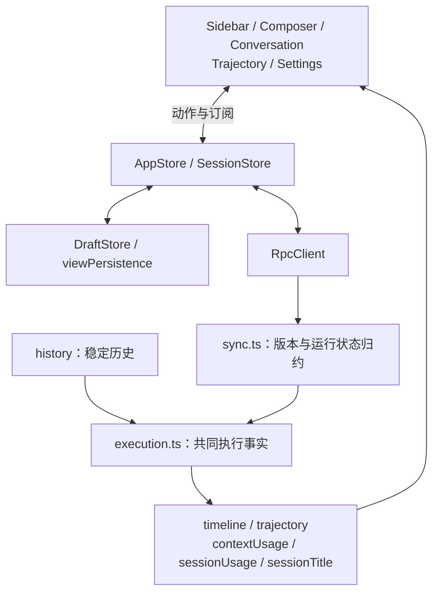

执行期间，Host 固定操作开始前的历史，并积累活动事件；收尾清除冻结历史与活动投影，下一次读取从日志生成历史。前端结算时立即显示空闲并暂留活动内容，补读成功后整体替换。用户与助手完成事件使用和历史相同的公开身份，增量与历史因此能在同一入口归约；完成事件的工具事实由独立工具事件承载。

Host 的活动恢复快照用正式完成内容替换对应增量，实时广播继续发送增量。普通 `session_changed` / `session_settled` 只传轻量 runtime；完整活动事件随 `session.read` 返回。前端分页检查任务与锚点，尾页刷新只保留连续重叠的前缀。

Store 逐帧归约，正文、思考和工具进度的显示通知合并，操作、终态和连接变化立即通知。组件按字段订阅，时间线与轨迹复用未变化条目的投影；上下文测量从事实尾部查找，遇到成功压缩或模型切换停止。

`inputTrigger.ts` 维护文件和技能候选触发，Composer 持有查询状态并丢弃失效结果。模型目录与推理档位由 `modelChoices.ts` 派生；共享交互由 `interactions.ts` 和 Menu、Dialog、Disclosure 等组件维护；主题变量位于 `styles/tokens.css`。

源码：[App](../apps/desktop/src/app.tsx) · [AppStore](../apps/desktop/src/appStore.ts) · [SessionStore](../apps/desktop/src/sessionStore.ts) · [执行事实](../apps/desktop/src/execution.ts) · [时间线](../apps/desktop/src/timeline.ts) · [轨迹](../apps/desktop/src/trajectory.ts)。

## 6. 桌面协议与同步

Rust `protocol/rpc.rs` 的方法表维护方法、参数和结果关联；前端声明从 Rust DTO 生成。传输增加请求 ID，Rust adapter 一次解析原始 JSON，并按相同 ID 返回结果或错误。阻塞磁盘操作使用 `spawn_blocking`，模型发现异步执行。

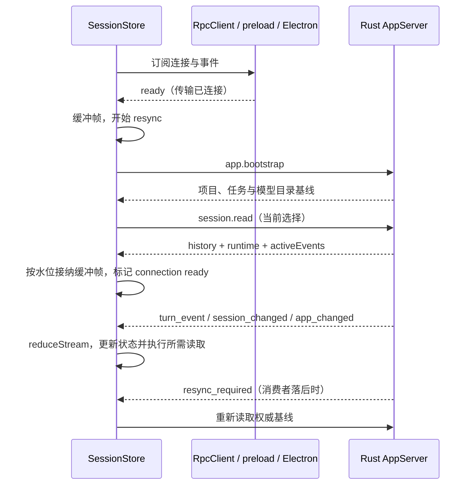

全局 `revision` 排序流帧，会话 `sessionRevision` 管理投影版本；目录刷新不推进执行事件消费水位。完整工作台快照构造与发布共用 `app_publication` 临界区，配置内容与序号在同一边界绑定。`sync.ts` 统一接纳 runtime 与事件，保持 `stopping`；`sessionStore.ts` 拥有选择序号、读取 Promise、缓冲释放与分页过程，失效读取不能覆盖新选择。

目录变更发布 `app_changed` 完整快照；创建返回新身份并保留到目录快照接纳；`session_settled` 触发历史补读和目录刷新。基线失败停止订阅并报告，草稿保留；后端退出要求重启应用，不自动重发修改请求。动作反馈统一由 `storeActions.ts` 管理，部分保存失败使用同一份原位错误。

Electron 加载 `singularity://app/`，渲染进程无 Node 能力，preload 只开放 RPC、连接和事件订阅。主进程只接受自有主 frame 的 IPC，原生目录选择在主进程处理，外部 HTTP(S) 链接交给系统浏览器。

源码：[RPC 合同](../crates/protocol/src/rpc.rs) · [RPC adapter](../crates/app/src/desktop/rpc.rs) · [Electron 主进程](../apps/desktop/desktop/main.ts) · [preload](../apps/desktop/desktop/preload.cts) · [连接](../apps/desktop/src/rpcClient.ts) · [同步归约](../apps/desktop/src/sync.ts)。协议更新步骤见[开发指南](development.md#协议更新)，传输取舍见[ADR](adr/adr-0001-electron-stdio.md)。

## 7. 一次发送的执行主链

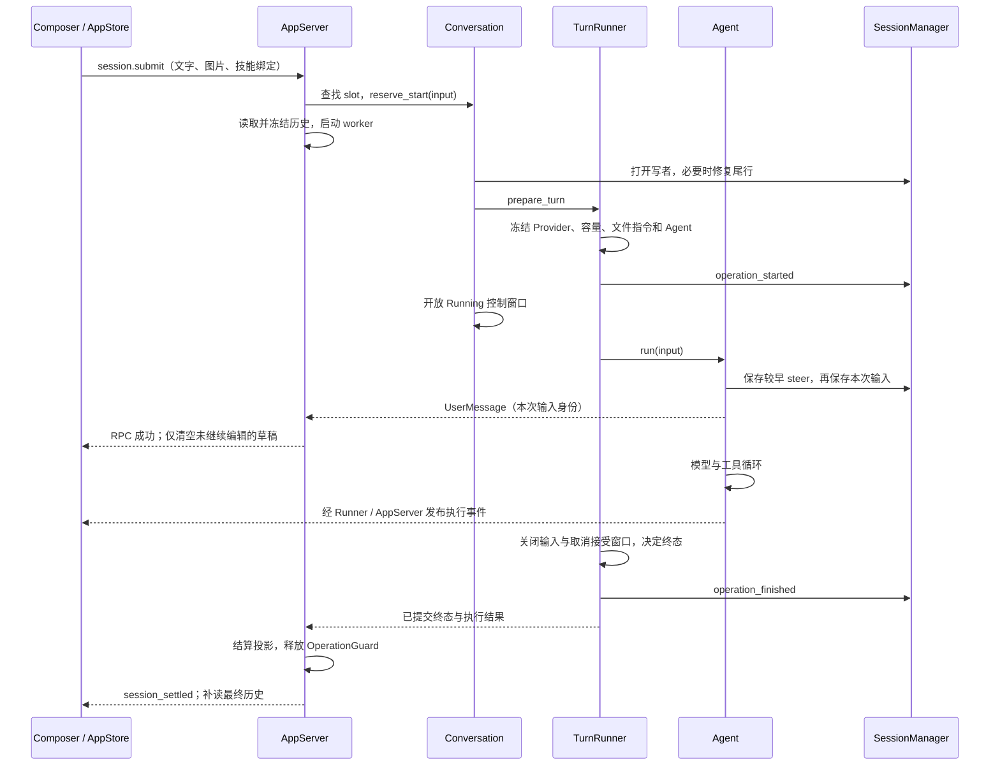

已有操作占用时普通提交返回 busy；历史读取、回合准备或输入保存失败时，释放操作并返回原错误，前端保留草稿。submit 回执按预订的消息身份匹配，不等待模型或工具完成。用户输入保存后发生的模型与工具错误经终态反馈。

Session 追加返回 `CommittedEntry` 的身份和落盘时间，Runner 用它构造操作事件。用户消息、正式助手消息、工具结果和终态均先提交再发布对应完成事件；正文与工具进度增量可在最终消息保存前显示。

源码：[提交入口](../crates/app/src/desktop/app_server/actions.rs) · [worker 与回执](../crates/app/src/desktop/app_server.rs) · [run_single_turn](../crates/runtime/src/conversation/execution.rs) · [TurnRunner](../crates/runtime/src/runner.rs)。

## 8. Agent 内部循环

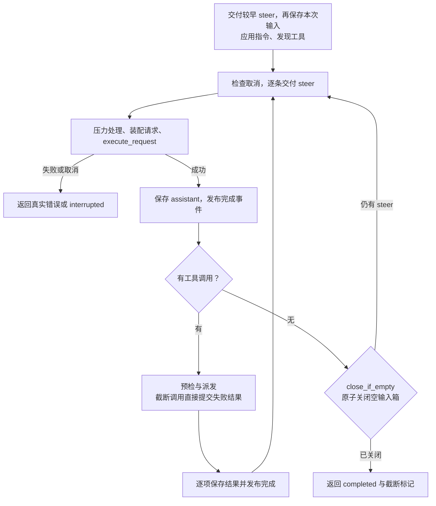

工具自身失败保存为模型可见的 `is_error` 结果；Session 写入失败结束执行。回复的公开正文和思考、工具调用及私有续接材料随正式 assistant 消息保存。工具日志按完成顺序追加，模型上下文按声明顺序配对。

源码：[Agent.run / 输入交付](../crates/agent/src/agent/mod.rs) · [请求准备](../crates/agent/src/agent/request.rs) · [工具派发](../crates/agent/src/agent/dispatch.rs) · [公共事件投影](../crates/runtime/src/assistant_items.rs)。

## 9. 引导输入与执行窗口

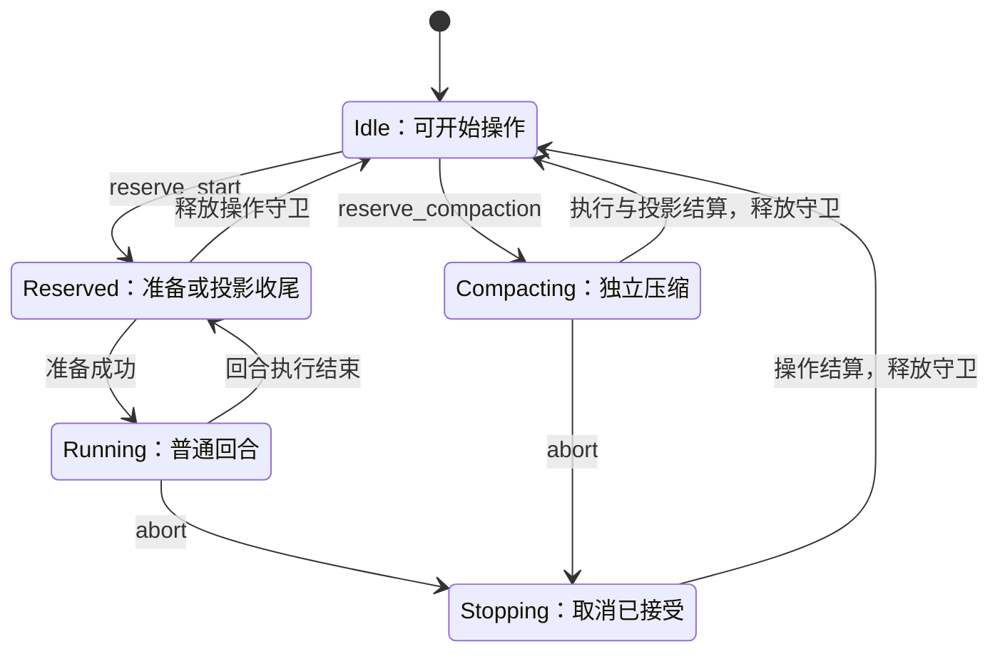

`Stopping` 是从取消令牌派生的公共 phase，内部仍持有原操作窗口。普通提交与独立压缩共用独占规则；运行中发送调用 `session.steer`，启动、停止及独立压缩期间不接受发送。

steer 在同一生命周期锁内检查窗口、分配 sequence 与消息身份并入箱；RPC 在接受后返回。Agent 在下一模型请求前逐条保存，成功后才确认消费，不改写已发出的模型请求或打断工具批次。保存期间不持输入箱锁。

失败结束当前执行，未消费的 steer 仍在 Conversation；下一次执行先消费较早输入，再纳入新提交。若重开日志已恢复该消息，只确认消费，避免重复保存或发布。输入箱不主动启动新执行。用户明确停止清空未消费的 steer；退出后内存输入不恢复。前端成功回执只清空未继续编辑的草稿。

源码：[Conversation 控制](../crates/runtime/src/conversation.rs) · [生命周期](../crates/runtime/src/conversation/state.rs) · [SteeringInbox](../crates/agent/src/agent/inbox.rs) · [Composer](../apps/desktop/src/components/Composer.tsx)。输入箱取舍见[ADR](adr/adr-0005-pending-input.md)。

## 10. 停止、失败与终态提交

停止接受后触发取消令牌，取消 HTTP / SSE、重试与提问等待，终止 shell 进程树；未启动工具生成取消结果。Runner 冻结停止事实后保存唯一的 `operation_finished`，再发布已提交终态；终态写入失败返回 Terminalization 错误。

停止是否被接受由取消窗口裁决：先接受的停止随本次操作收敛，终态先冻结则后续停止返回不可停止。普通回合与独立压缩共用该规则，成功返回前已接受停止时提交中断终态。停止事实由终态记录，不另写一条停止日志。

追加 I/O 失败后写者拒绝继续追加，重开写者走尾部修复。终态写入失败同时保留执行错误和存储原因；桌面收尾错误不能替代持久终态。进度或客户端输出故障不改写执行事实。

内部 panic 由 `panic = "abort"` 终止后端，工作台提示重启；普通模型、网络和文件错误经 Result 传播。关闭窗口隐藏到托盘，刷新保留后台任务；托盘退出关闭管道，Rust 取消并等待结算，Electron 超时后终止后端。重启按已保存事实恢复。

源码：[取消窗口](../crates/runtime/src/conversation/state.rs) · [Runner 收尾](../crates/runtime/src/runner.rs) · [终态错误](../crates/runtime/src/runner/error.rs) · [应用退出](../crates/app/src/desktop/app_server/shutdown.rs) · [Electron 生命周期](../apps/desktop/desktop/main.ts)。

## 11. 模型配置与选择

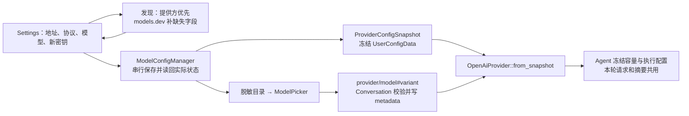

配置与密钥分文件保存；部分保存失败返回真实状态与原因，Runner 和目录按实际磁盘刷新。快照不创建网络客户端，执行准备才按 selector 创建本轮 Provider。运行中的模型和容量保持冻结，设置变更影响下次操作。

模型发现不直接修改配置。提供方元数据优先，models.dev 按实际端点与精确模型 ID 补缺；导入更新智能管理字段并保留用户覆盖。思考开关、budget 与 effort 分别表达，未选变体保留服务端默认。认证、配置、网络、限流与响应格式错误保留各自类别。

改名和模型设置经 Conversation 共用写者选择规则：运行时复用活动写者，空闲时短开写者，落盘成功才更新内存。相同选择不重复写入；没有默认模型的新任务等待选择。

源码：[配置与快照](../crates/model/src/config/manager.rs) · [selector](../crates/model/src/config/selection.rs) · [发现](../crates/model/src/config/discovery.rs) · [元数据](../crates/model/src/config/model_metadata.rs) · [端点与选项](../crates/model/src/openai/wire.rs)。元数据取舍见[ADR](adr/adr-0002-model-metadata.md)。

## 12. 模型协议、重试与续接

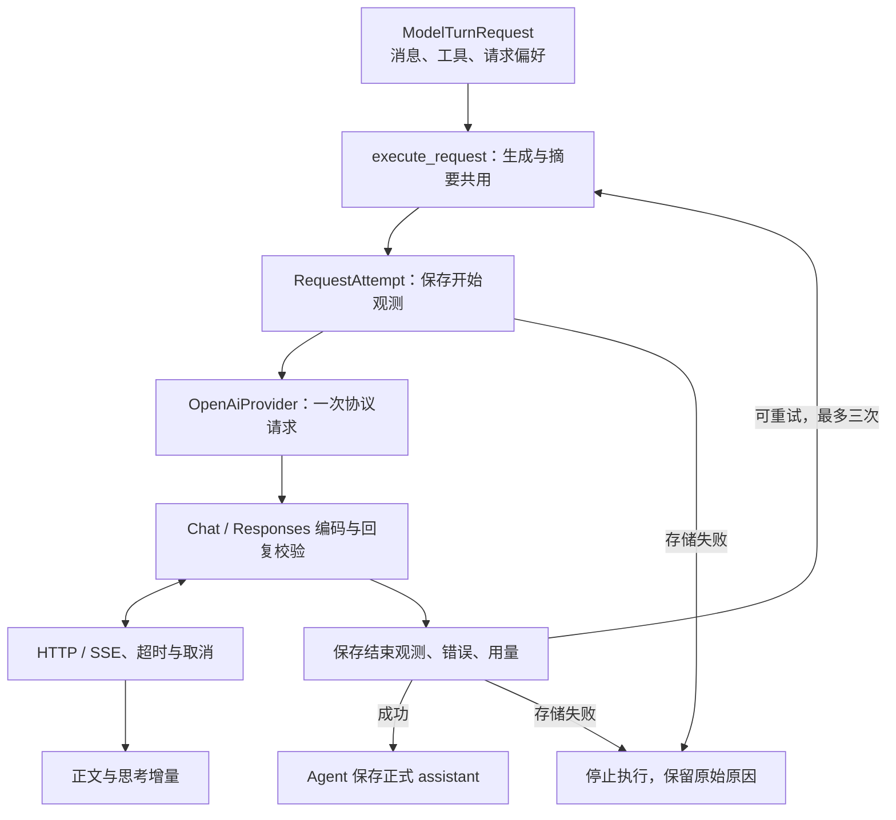

开始观测保存成功后才发送 HTTP；结束观测失败停止执行，同时保留模型错误。耗时从开始记录前到模型返回，包含编码、网络和校验。退避等待可取消；重试复用输入，另分配尝试和输出身份，并以 `item/discarded` 清除临时增量。最终失败或取消的半截内容保存为 `assistant_interrupted` 展示记录，不进入后续模型上下文或摘要。

SSE 在协议终态完成该次回复；回复结构与工具身份在 Provider 边界校验，工具 JSON 参数由注册表 preflight 校验。上下文溢出走[缩减恢复](#context)，与网络重试分开。摘要使用同一请求链但不广播对话增量。

公开正文和 thinking 可展示；Chat reasoning 原字段、reasoning_details 及 Responses 原输出项和加密 reasoning 作为私有续接材料保存。下次发送核对提供方、模型、协议与工具绑定，兼容时回传；切换不兼容模型时保留公开内容并移除不兼容私有部分。effort 变化不改变历史身份；私有材料不能从可见思考重建。

源码：[请求执行](../crates/agent/src/request_execution.rs) · [Provider 合同](../crates/model/src/provider/contract.rs) · [OpenAI Provider](../crates/model/src/openai/provider.rs) · [Chat](../crates/model/src/openai/chat.rs) · [Responses](../crates/model/src/openai/responses.rs) · [传输](../crates/model/src/transport/mod.rs) · [消息转换](../crates/agent/src/message.rs)。

## 13. Harness 指令、项目指令与技能

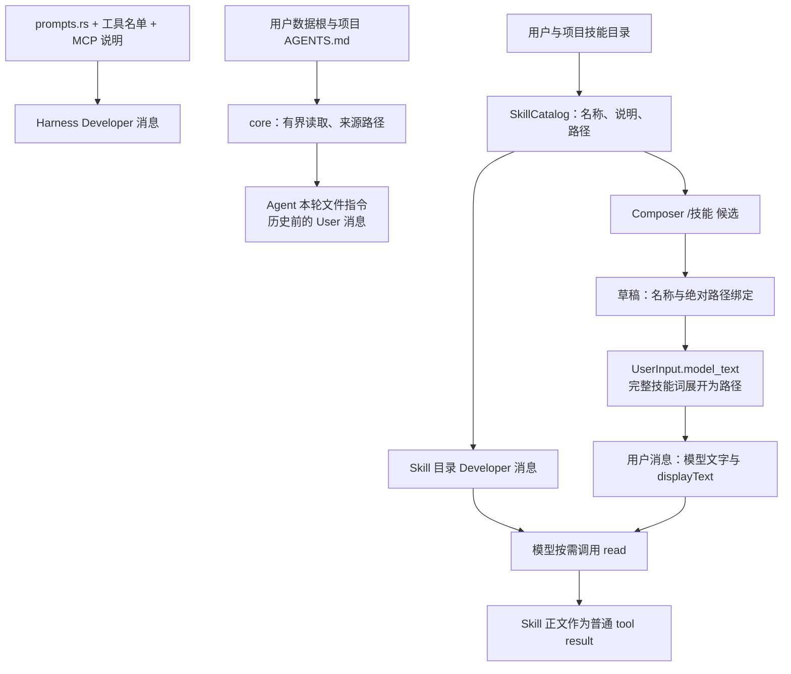

Runner 首次准备读取文件指令，Agent 每轮及压缩后发现 Skill 元数据，文件指令在压缩后重读并覆盖本轮值。文件指令作为历史之前的请求前缀，不随对话压缩。用户与项目指令指向同一路径时只读一次。每文件上限 32 KiB、总计 64 KiB，截断有诊断；读取失败或保留内容非法 UTF-8 结束准备。

选中技能保存名称与路径绑定，普通提交和 steer 共用展开规则；模型、计量、摘要与恢复消费展开后的文字，界面和任务标题使用原始 displayText。Skill 正文由模型调用 `read` 获取，读取结果进入普通历史，加载目录不执行脚本。

源码：[提示词](../crates/agent/src/prompts.rs) · [文件指令](../crates/core/src/project_instructions.rs) · [技能发现](../crates/core/src/skills.rs) · [引用展开](../crates/agent/src/agent/inbox.rs) · [请求前缀](../crates/agent/src/agent/request.rs)。目录、元数据与可见性约定见[安装说明](INSTALL.md#skills)。

## 14. 模型上下文与压缩

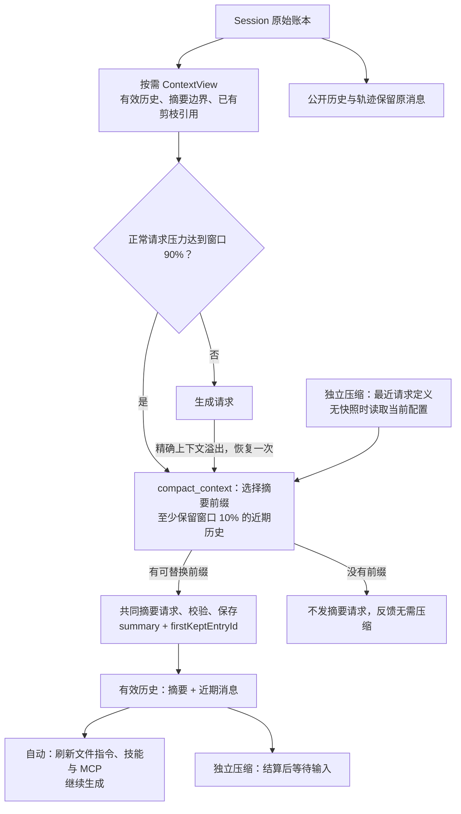

`SessionManager` 提交成功后在同一写者锁内更新内存账本。请求与缩减按需派生 ContextView，依据摘要锚点、工具调用顺序和已保存的剪枝记录重建；压缩只追加替换记录，不删除原消息或图片，也不生成新的工具剪枝记录。图片加载在写者锁外进行。

切点保护完整消息与工具调用、结果配对。摘要前保持历史正文原样；首次按目标、约束、进度、决定、下一步和关键上下文生成摘要，再次压缩用新增覆盖消息更新已有摘要。结果必须非空且未截断，成功保存才重建视图。

生成与摘要共用输出预算：模型输出上限、目标上限和窗口剩余空间取较小者；安全余量为窗口 5%、最多 4096 Token，摘要目标最多 8192 Token。压力包含历史、指令、工具 schema 与本轮实测校正；摘要提交或文件指令刷新清零校正。估价只用于请求准备，用量展示取 Provider 实测。

自动压缩和溢出恢复沿用当前指令与工具，摘要提交后重读文件指令、技能和 MCP；独立压缩复用最近定义，跨重启可读，无定义才发现当前配置。摘要、取消、存储或文件指令失败结束操作；溢出恢复失败保留真实错误类型，恢复成功后只重发一次。

独立压缩终态标明操作来源，不改变任务回合状态：有摘要时显示持久条目，无可压缩内容时显示完成反馈，失败时显示具体原因。摘要用量计入请求观测与会话汇总，compaction 条目只保存正文和保留锚点。

摘要、指令刷新与请求记录的设计理由见[上下文 ADR](adr/adr-0006-context.md)。

源码：[ContextView](../crates/agent/src/session/context.rs) · [重建](../crates/agent/src/session/context/resolution.rs) · [压力与溢出](../crates/agent/src/agent/request.rs) · [缩减编排](../crates/agent/src/agent/compaction.rs) · [摘要准备](../crates/agent/src/compaction.rs) · [独立压缩](../crates/runtime/src/runner/compaction.rs)。

## 15. 工具、MCP 与图片

### 注册与调度

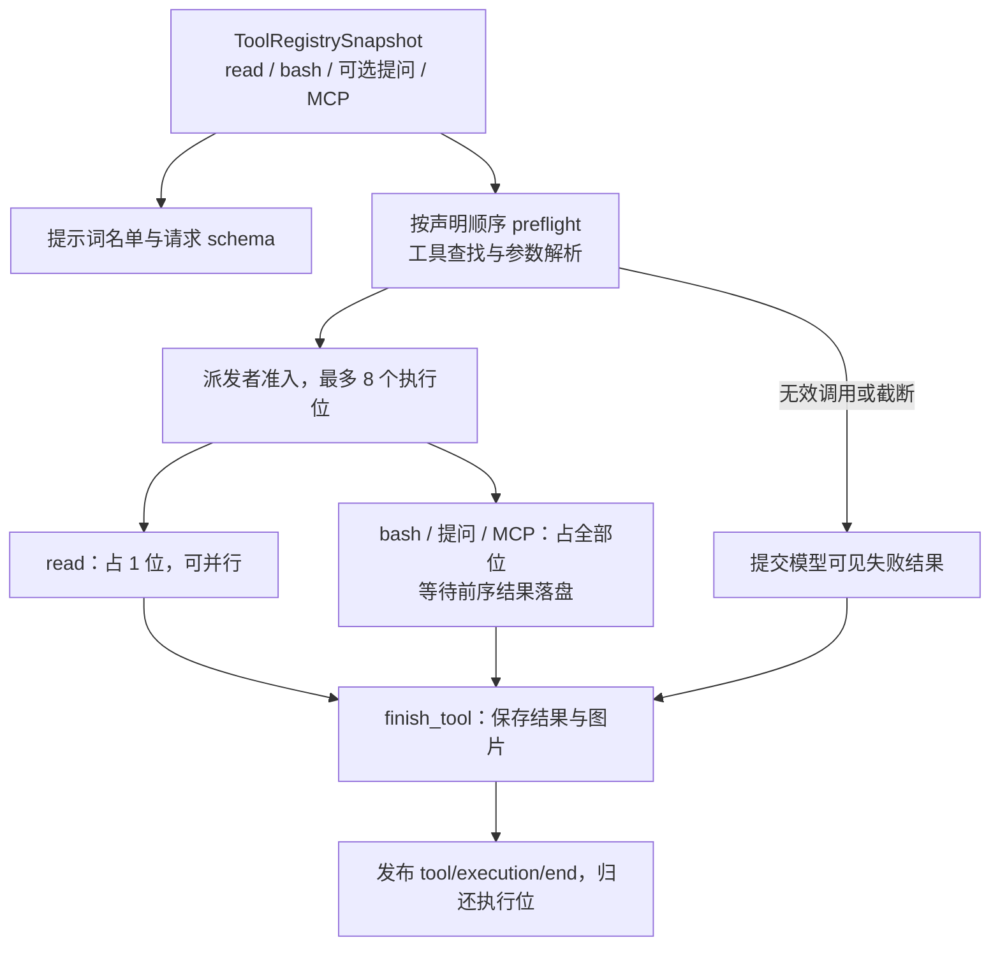

准备参数按值交给 worker，进度与完成携带公开条目身份；结果提交失败停止后续派发并排空已启动任务的事件。只有 `read` 并行，MCP 不凭只读提示扩大并发。模型、重试和派发共用异步链；文件读取与 shell 管理在 blocking pool 执行。

`read` 提供有界文本、源行范围和图片读取，Skill 正文也使用它。搜索与文件修改通过 `bash` 调用 `rg`、Python 等本机命令，权限、行尾、原子性和并发协调由具体命令负责，工作台呈现命令输出。

`bash` 使用 Git Bash 和 Windows Job Object 管理整个进程树，调用结束回收后代；长任务在同一次调用内前台执行。完整输出持续收集，首份进度立即发布，后续累计尾部快照最多每 100 毫秒发布；最终有界结果与截断说明独立完整。收尾读取错误保留退出码、超时或取消原因及已捕获输出。

### MCP 与交互提问

应用装配的 `McpManager` 由设置 RPC 与 Runner 共享。官方 `rmcp` SDK 负责 stdio / Streamable HTTP 初始化、分页发现、请求配对和超时。发现结果按服务器及工具名称排序后合入注册表，首次模型请求携带全部可用工具，连续请求复用当前定义。

连接按 cwd 与服务器身份复用，只缓存成功连接。配置变化或显式重连替换后续连接，活动快照仍持原连接；下一回合和压缩后刷新接纳新目录。连接失败同时给出用户诊断与模型可见说明，下一次发现可重新连接。工具调用不自动重试，停止发送取消通知；退出时关闭连接并回收本地服务器进程树。

交互宿主启用 `ask_user_question`，`TurnControls` 持有 `UserQuestions`。工具在独占准入内等待答案或取消；`pendingQuestion` 经 runtime 快照展示，`session.answerQuestion` 按条目身份交付。调用与答案分别保存在 assistant 和 tool result 中，刷新恢复等待快照，重启按中断历史处理。

### 图片数据流

前端选择、粘贴和拖放图片后，将其与文字、技能绑定保存为同一草稿。RPC 接受边界解码为 `UserInput`；`read` 按文件签名识别图片；MCP 图片结果也进入 Agent 图片校验与保存流程。消息引用持久像素，`session.imageRead` 只按实际历史或待处理输入提供预览，不接受任意路径。

模型与摘要按需加载快照。Chat 把工具图片放到完整工具结果组之后的 user 消息，Responses 在 `function_call_output.output` 使用 `input_image`；并行工具配对保持完整。图片估价参与压力计算，原像素与历史不随压缩删除，摘要可保留快照路径供后续 read。

源码：[注册表](../crates/agent/src/tools/registry.rs) · [派发](../crates/agent/src/agent/dispatch.rs) · [read](../crates/agent/src/tools/read.rs) · [bash](../crates/agent/src/tools/bash/mod.rs) · [MCP 管理](../crates/mcp/src/lib.rs) · [MCP 结果](../crates/agent/src/tools/mcp.rs) · [提问](../crates/agent/src/agent/questions.rs) · [图片](../crates/agent/src/image.rs)。取舍见[文件工具 ADR](adr/adr-0005-file-tools.md)、[MCP ADR](adr/adr-0004-mcp-tools.md)、[图片 ADR](adr/adr-0003-image-input.md)。

## 16. 请求观测与定义快照

请求定义先保存为 `request_definitions`，`RequestContext` 引用定义 ID 与本次选项。`RequestAttempt` 产生开始、结束观测，并向实时事件和持久轨迹交付同一 `RequestObservation`；所有尝试及摘要用量由请求账本汇总。

定义先于引用写入；历史读取从 RequestContext 解析同一请求头，结束观测保留开始时间与请求定义。requestId 由观测统一承载，输出另分配条目 ID。失败类别与诊断码随观测保存，成功前的失败尝试仍可回溯。请求观测不进入模型上下文，也不另存每次请求完整对话。

用量缺失保持未知，`usagePresent` 表示至少一次完整上报输入与输出；缓存字段缺失与明确零命中不同。协议结果校验失败仍累计已上报用量。回合终态的持久记录保存状态、错误和停止事实，用量由请求账本聚合。

源码：[RequestAttempt / 计量](../crates/agent/src/request_execution.rs) · [定义与引用](../crates/agent/src/session/request.rs) · [公开历史](../crates/runtime/src/history.rs) · [前端用量](../apps/desktop/src/sessionUsage.ts)。

## 17. 历史读取、写入与恢复

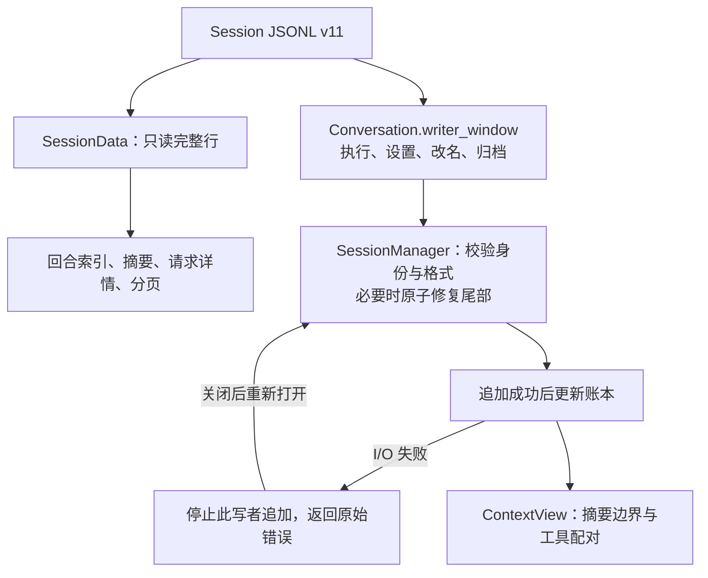

启动先取得数据根的 `instance.lock` 系统锁。会话 writer window 协调持久修改，活动执行共用同一 SessionWriter；目录和分页直接读取日志构造不可变快照，只读打开不派生模型上下文。

只读忽略未闭合尾行，写打开时修复撕裂尾部并保留完整条目身份、顺序和内容；非尾部损坏或核心格式无效明确失败。只接受当前 v11，不自动迁移旧格式。RPC 按 sessionId 读取并核对 header.id，执行 cwd 来自会话；历史读取不要求目录仍存在，执行或压缩准备才检查目录。

`message`、`compaction`、`metadata` 与 `record` 分别承载消息、上下文替换、任务设置和操作／请求事实。缺少终态记录的历史回合投影为中断；缺失工具结果在模型视图中标明未知并要求先检查状态，恢复不重放 shell 或文件副作用。已保存的 `tool_result_pruned` 记录仍参与模型视图重建。

ThreadCatalog 从回合索引派生名称、状态、轮数和 updatedAt，按需展开历史页；运行 phase 取 Conversation，空闲结果取日志。归档在写者窗口内移动文件，不解析或修复正文。未消费输入只存在进程内，重启由用户继续已保存历史。

源码：[Session 格式](../crates/agent/src/session/format.rs) · [账本与写者](../crates/agent/src/session/manager.rs) · [尾部处理](../crates/agent/src/session/file.rs) · [历史索引](../crates/runtime/src/history.rs) · [目录与分页](../crates/runtime/src/thread_catalog.rs)。

## 18. 构建、发布与无交互入口

React 经 Vite 构建 production dist，Electron main / preload 经 TypeScript 编译为 desktop-dist；`prepare:runtime` 复制 Cargo 构建的后端，Electron Builder 将三者打成完整 Windows 目录，再归档为 ZIP 并生成 SHA256。运行和发布命令由[开发指南](development.md)维护。

JSONL 准备失败也输出 failed summary。stdout 写入失败后无法确认该通道的行边界，因此停止追加所有行（包括 summary）；执行事实仍持久化，输出故障与准备或执行结果均保留，进程以失败退出。外部强制终止或异常进程退出不保证 summary。评估器在独立仓库，本项目维护共享 Agent 的无交互接口。

源码：[前端构建](../apps/desktop/package.json) · [后端准备](../apps/desktop/desktop/prepare.mjs) · [打包配置](../apps/desktop/electron-builder.json) · [JSONL](../crates/app/src/jsonl_mode.rs) · [发布工作流](../.github/workflows/release.yml)。命令与单实例启动步骤见[开发指南](development.md)。

## 19. 按改动目的定位关联代码

| 要改变的行为 | 维护入口 | 直接关联的使用方与边界 |
| --- | --- | --- |
| 工具定义与执行 | [registry](../crates/agent/src/tools/registry.rs)、[dispatch](../crates/agent/src/agent/dispatch.rs) | 提示词、schema、预检、并行准入、取消、结果落盘与公开投影。 |
| 命令执行 | [bash](../crates/agent/src/tools/bash/mod.rs) | 搜索与文件修改、Git Bash、工作目录、输出、超时与进程树。 |
| MCP 接入 | [McpManager](../crates/mcp/src/lib.rs)、[Agent MCP 结果](../crates/agent/src/tools/mcp.rs) | 设置、连接生命周期、工具刷新、模型 schema、图片结果与退出。 |
| 发送、steer、停止或提问 | [Conversation](../crates/runtime/src/conversation.rs)、[Runner](../crates/runtime/src/runner.rs) | 桌面 RPC、输入箱、Composer、QuestionPanel、持久终态、JSONL 入口。 |
| 事件或 RPC 字段 | [protocol](../crates/protocol/src/lib.rs)、[adapter](../crates/app/src/desktop/rpc.rs) | 生成声明、JSONL、流信封、恢复快照、同步与展示。 |
| 会话格式或历史 | [session](../crates/agent/src/session/mod.rs)、[history](../crates/runtime/src/history.rs) | 工具配对、摘要锚点、请求引用、目录、分页和前端执行事实。 |
| 模型能力与协议 | [model](../crates/model/src/lib.rs)、[request_execution](../crates/agent/src/request_execution.rs) | selector、冻结配置、重试、续接身份、摘要、观测、模型设置。 |
| 上下文与摘要 | [请求准备](../crates/agent/src/agent/request.rs)、[缩减](../crates/agent/src/agent/compaction.rs) | 自动、手动、溢出恢复、历史完整性、指令刷新和用量。 |
| 指令与技能 | [文件指令](../crates/core/src/project_instructions.rs)、[技能](../crates/core/src/skills.rs)、[引用](../crates/agent/src/agent/inbox.rs) | 候选绑定、普通提交与 steer、read、请求前缀与压缩后刷新。 |
| 项目与文件候选 | [WorkspaceStore](../crates/app/src/desktop/workspace_store.rs)、[workspace](../crates/app/src/desktop/app_server/workspace.rs)、[候选](../crates/app/src/desktop/workspace_files.rs) | 路径身份、cwd 分组、原生目录选择、离线历史与移除条件。 |
| 流式显示与恢复 | [SlotState](../crates/app/src/desktop/app_server/session.rs)、[SessionStore](../apps/desktop/src/sessionStore.ts)、[sync](../apps/desktop/src/sync.ts) | 版本水位、历史与活动拼接、phase、分页、正文与轨迹。 |
| 草稿、布局与滚动 | [drafts](../apps/desktop/src/drafts.ts)、[viewPersistence](../apps/desktop/src/viewPersistence.ts)、[AppStore](../apps/desktop/src/appStore.ts) | 分任务输入、草稿转移与清理、焦点、锚点、组件和样式。 |
| 构建与发布 | [桌面构建](../apps/desktop/package.json)、[prepare](../apps/desktop/desktop/prepare.mjs)、[发布](../.github/workflows/release.yml) | production 资源、后端复制、Windows 包、运行和安装文档。 |

表中列出理解和修改同类行为所需的入口。验证按本次实际影响选择，原则见[项目指令](../AGENTS.md#验证与交付)；控件约定由[工作台交互](desktop-ui.md)维护。
