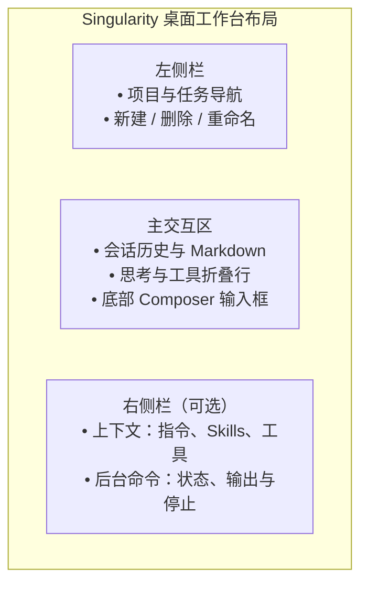

# 工作台交互

本文记录工作台各控件已经确认的操作方式：键盘、焦点、草稿、浮层位置和出错时的显示。改界面前先对照这里，改完同步更新。

## 发送与阅读

输入 `@` 搜索项目文件（最多显示 12 项），在开头或空白后输入 `/` 搜索可用 Skills。

空闲时发送消息开始新的一轮；运行中发送的消息排队，在下一次模型请求前交给模型。刷新或关闭窗口不会停止正在运行的任务。

首次发送使用点击发送时选定的项目和模型。空白页从默认模型开始选择，创建后的任务保存自己的选择，修改默认值不切换已有任务的模型。项目列表读取期间或读取失败时，发送按钮同步禁用并显示原因。发送失败保留草稿；成功后只清理发送后没有再编辑的内容。等待期间可以切换页面，发送完成后停留在用户当前所在的页面。

打开任务时读取完整历史，并按条目和偏移恢复上次的阅读位置。消息一经接受就可以停止任务，准备、执行和收尾阶段都显示停止按钮。回复达到输出上限时保留正文并显示未完成的原因，重新打开任务仍能看到。思考档位直接显示提供方使用的名称，模型编辑页只提供当前配置可用的档位或开关；已有无效选项保留并提示修正。

自动重试期间保持运行状态和停止按钮，不单独显示重试提示；重试规则见[架构说明](architecture.md#模型请求)。

回复完成时，正文、思考和工具按实际保存顺序显示；工具等待时显示“等待执行”，开始和完成只更新原位置；停止后不再显示等待，重新打开任务后顺序相同。

结果保存失败后，当前页面保留已收到的临时内容，结束运行状态并显示错误。重新打开任务只显示实际保存的历史。

删除任务会停止该任务，删除会话日志和附件，并清理草稿和阅读位置。当前任务被删除后回到同项目的空白页。

## 运行状态侧栏

右侧按钮打开运行状态，可在“上下文”和“后台命令”之间切换。上下文显示当前任务实际加载的内容：全局和项目指令按文件列出路径，点击展开正文；Skills 和工具按分类折叠，展开后列出名称。切换任务时跟着切换；重启后还没加载时显示空状态。后台入口直接打开后台命令页。已结束命令的状态和输出从会话日志读取，重开任务后仍可查看；只有仍在运行的命令可以停止。

侧栏宽度可拖动或聚焦分隔条按左右方向键调整；按 Escape 关闭右侧栏并把焦点还给入口按钮，窗口较窄时右侧栏覆盖主区域并将 Tab 焦点限制在侧栏内。分类切换支持左右方向键，面板内展开项均沿用 Disclosure 动效。

有弹窗、浮层或输入候选时，Escape 先关闭当前这一层，右侧栏保持展开。没有这些内容时，Escape 关闭右侧栏。

## 交互提问面板（`ask_user_question`）

当模型在执行中调用交互提问工具时，Composer 输入区自动切换为问答卡片：
- **分页展示**：多题问答一次展示一道题，底部支持向前/向后切换；单题不显示页码和翻页按钮；
- **作答类型**：支持单选、多选及自由文本填写；
- **提交控制**：答完后一次提交给等待中的工具调用，可以跳过单个问题。问答卡片只负责作答，停止整个任务仍用输入区右下角的停止按钮。
- **切换任务**：未提交的答案和当前题号保留在当前工作台内存中；切回任务可继续填写。提交成功或问题结束后清理，刷新或退出应用后不保留。

## 设置

API Key 只能写入，界面只显示是否已配置。设置弹窗中的输入框、复选框和下拉框沿用全局键盘焦点样式，按 Tab 切换时显示焦点位置。MCP 保存期间，表单字段、保存和取消均不可用；失败后恢复编辑并保留已填内容，成功后更新列表并关闭表单。开关和删除也直接更新列表；读取失败时可点击“重新读取”。打开设置只查看已有状态，不主动建立连接；连接失败时可点击“重试连接”。

取消或收起提供方编辑器、切换设置分类或关闭设置后，尚未返回的模型列表查询结果不再打开模型选择列表。

## 弹窗与浮层

模态弹窗使用原生 `dialog.showModal()`，由 Chromium 管理层叠、背景不可操作、Tab 焦点范围和关闭后的焦点。Escape 或点击遮罩关闭最上层弹窗；弹窗内部菜单仍独立响应 Escape。

任务菜单、模型选择、协议选择和项目颜色使用原生 Popover 管理展开、点击外部关闭与按 Escape 返回焦点。按 Tab 可移到浮层外的下一个控件，列表内支持方向键、Home 和 End 选择。点击菜单项会先关闭浮层再打开对应对话框；选择模型后仍可继续调整思考档位。浮层位置跟随触发按钮：模型浮层向上、靠右对齐，间距 8px；其他浮层向下、靠左对齐，间距 6px，下方空间不足时向上展开，距窗口边缘至少留出 8px。协议浮层与按钮等宽。

## 动效

系统开启“减少动态效果”时，所有过渡立即完成。配色和动效时长以样式文件为准。
