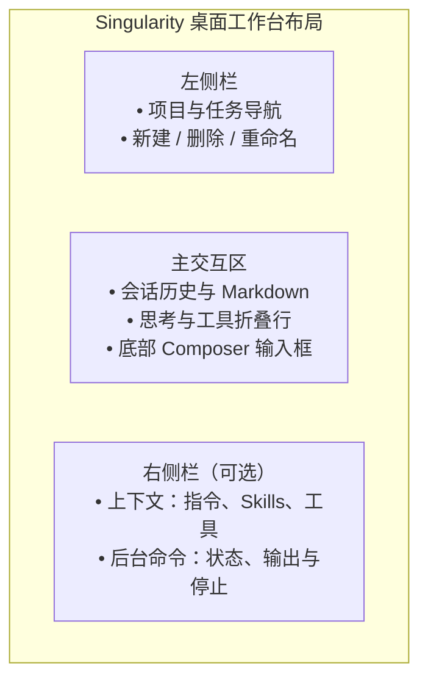

# 工作台交互指南

本文档介绍 Singularity 桌面工作台的界面布局、操作交互与视觉规范。

---

## 发送与阅读

输入 `@` 后搜索项目文件，候选最多显示 12 项。

首次发送使用点击发送时选定的项目和模型。空白页从默认模型开始选择，创建后的任务保存自己的选择，修改默认值不切换已有任务的模型。项目列表读取期间或读取失败时，发送按钮同步禁用并显示原因。发送失败保留草稿；成功后只清理发送后没有再编辑的内容。等待期间可以切换页面，发送完成后停留在用户当前所在的页面。

打开任务时读取完整历史，并按条目和偏移恢复上次的阅读位置。消息一经接受就可以停止任务，准备、执行和收尾阶段都显示停止按钮。回复达到输出上限时保留正文并显示未完成的原因，重新打开任务仍能看到。思考档位直接显示提供方使用的名称，模型编辑页可以选择档位或开关。

网络故障、超时、限流或服务繁忙时，即使已经显示部分正文或思考，也会按既定策略自动重试。重试前移除本次未完成的输出，再重新生成回复；等待期间保持运行状态和停止按钮，不单独显示重试提示。最多尝试三次，最后一次失败时保留已生成的部分并显示错误。这是预期的自动恢复交互。

回复完成时，正文、思考和工具按实际保存顺序显示；工具等待时显示“等待执行”，开始和完成只更新原位置；停止后不再显示等待，重新打开任务后顺序相同。

结果保存失败后，当前页面保留已收到的临时内容，结束运行状态并显示错误。重新打开任务只显示实际保存的历史。

删除任务会停止该任务，删除会话日志和附件，并清理草稿和阅读位置。当前任务被删除后回到同项目的空白页。

## 运行状态侧栏

右侧按钮打开运行状态，可在“上下文”和“后台命令”之间切换。上下文显示当前任务实际加载的内容：全局和项目指令按文件列出路径，点击展开正文；Skills 和工具只列名称。切换任务时跟着切换；重启后还没加载时显示空状态。后台入口直接打开后台命令页。已结束命令的状态和输出从会话记录读取，重开任务后仍可查看；只有当前进程管理的命令可以停止。

侧栏宽度可以拖动调整；窗口较窄时侧栏覆盖主区域，按 Escape 关闭并把焦点还给入口按钮。分类支持左右方向键，指令展开沿用 Disclosure 动效。

## 交互提问面板（`ask_user_question`）

当模型在执行中调用交互提问工具时，Composer 输入区自动切换为问答卡片：
- **分页展示**：多题问答一次展示一道题，底部支持向前/向后切换；单题不显示页码和翻页按钮；
- **作答类型**：支持单选、多选及自由文本填写；
- **提交控制**：答完后一次提交给等待中的工具调用，可以跳过单个问题。问答卡片只负责作答，停止整个任务仍用输入区右下角的停止按钮。
- **切换任务**：未提交的答案和当前题号保留在当前工作台内存中；切回任务可继续填写。提交成功或问题结束后清理，刷新或退出应用后不保留。

---

## 视觉规范与动效约定

### 主题配色

| 类别 | 浅色主题 (Light) | 深色主题 (Dark) | 适用场景 |
| :--- | :--- | :--- | :--- |
| **画布背景** | `#ffffff` | `#191919` | 窗口底层底色 |
| **容器表面** | `#ffffff` | `#242424` | 侧栏、输入框、面板表面 |
| **强调色** | `#db2777` (Pink-600) | `#f472b6` (Pink-400) | 主按钮、选中态、连接与焦点 |
| **状态：成功** | `#34c759` | `#30d158` | 正常完成标识 |
| **状态：错误** | `#ff3b30` | `#ff453a` | 失败与中断提示 |

设置弹窗中的输入框、复选框和下拉框沿用全局键盘焦点样式；使用 Tab 切换时显示当前位置。MCP 保存期间，编辑字段、保存和取消均不可用；失败后恢复编辑并保留表单内容，成功后按返回的配置和已有连接状态更新列表并关闭表单。开关和删除同样直接使用操作结果更新列表；首次读取列表失败时提供“重新读取”。列表和状态一次读取，查看不会启动连接；“重试连接”独立执行。

取消或收起提供方编辑器、切换设置分类、关闭设置后，未返回的模型发现结果立即失效，不再打开模型列表。

### 关键过渡动效

- **侧栏开合**：280ms 缓入缓出过渡；
- **折叠面板（Disclosure）**：展开 250ms，收起 200ms，带 2px 模糊消除与高度渐变；
- **工具栏加号变形（Morph）**：从圆按钮平滑过渡至弹出菜单，展开 350ms，收起 250ms；
- **浮层动画**：缩放 + 位移 + 淡入（展开 250ms，收起 200ms）；
- **系统减少动态效果（prefers-reduced-motion）**：开启时所有过渡时间归零，立即切换。

模态弹窗使用原生 `dialog.showModal()`，由 Chromium 管理层叠、背景不可操作、Tab 焦点范围和关闭后的焦点。Escape 或点击遮罩关闭最上层弹窗；弹窗内部菜单仍独立响应 Escape。

任务菜单、模型选择、协议选择和项目颜色使用浏览器原生 Popover 管理浮层、外部点击关闭与 Escape 返回焦点。Tab 可以移到浮层外的下一个控件；各选择器保留原有方向键、Home、End 操作。菜单动作关闭浮层后打开对应对话框，模型选择后仍可继续调整思考程度。位置由 CSS 跟随触发按钮：模型浮层向上、右侧对齐，间距 8px；其他浮层向下、左侧对齐，间距 6px，下方不足时向上展开，窗口边缘留出 8px。协议浮层与按钮等宽。
