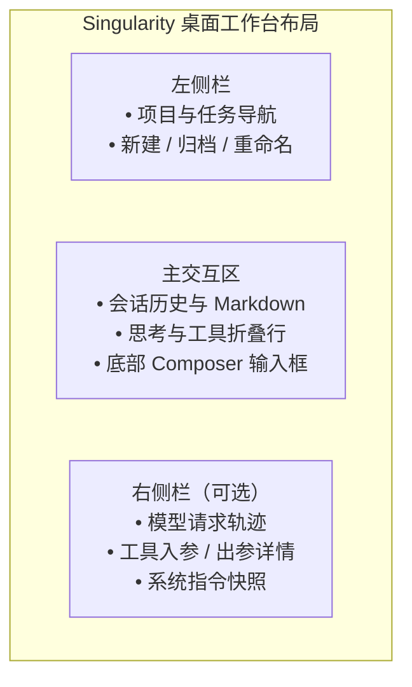
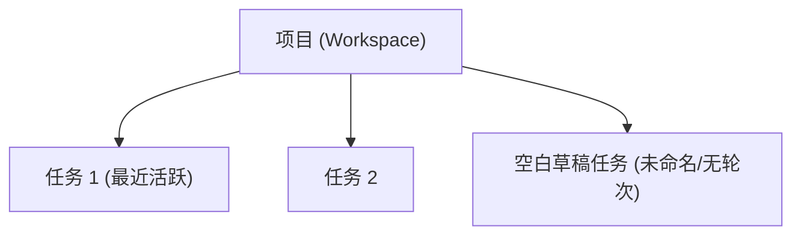
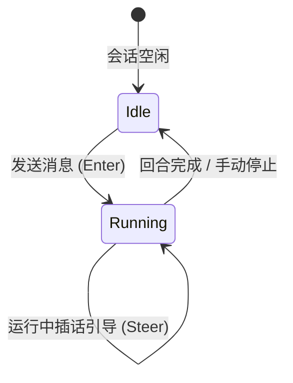
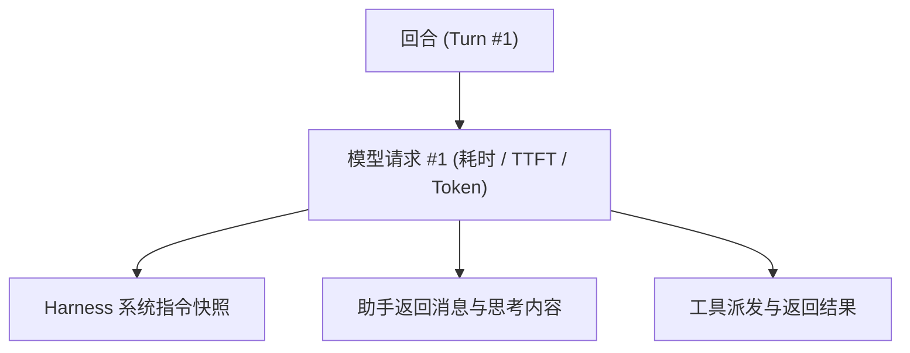

# 工作台交互指南

本文档介绍 Singularity 桌面工作台的界面布局、操作交互与视觉规范。



---

## 1. 项目与会话导航（左侧栏）

侧边栏按**项目（Workspace）**分组，任务按最近更新时间降序排列。



### 核心操作与交互规则

| 操作 | 触发入口 | 交互行为与说明 |
| :--- | :--- | :--- |
| **添加项目** | 顶栏文件夹图标 | 打开 Windows 原生文件夹选择窗口，选定后登记为工作区。 |
| **新建任务** | 项目旁常驻 `+` 按钮 | 展开该项目分组并创建任务；若已有未提交的空白会话，则直接复用。 |
| **切换任务** | 单击任务行 | 切换右侧主界面内容，保留当前任务的输入草稿与阅读锚点。 |
| **任务重命名** | 任务右键菜单 / 弹窗 | 修改任务标题，执行中亦可重命名。 |
| **任务归档** | 任务右键菜单 | 停止进行中的回合，完成日志收尾后移入归档列表；归档清理当前草稿。 |
| **移除项目** | 项目菜单 | 移除项目登记（保留磁盘源码与会话文件）；运行中任务会阻止移除。 |

- **项目颜色**：项目统一使用实心圆。点击圆点打开一排预设颜色，选中后收起；颜色保存在本地桌面视图配置中。
- **折叠与记忆**：项目分组折叠状态自动保存；左侧栏与右侧轨迹面板的宽度（220–420px）各自独立记忆在本地。

---

## 2. 对话与消息流（主栏）

主交互区展示当前任务的完整对话流水与执行过程。

### 消息类型与展示规则

1. **用户输入**：原样展示文本。支持粘贴/拖拽图片，显示缩略图，点击可全屏预览。
2. **助手回答**：支持标准 Markdown、代码块语法高亮及 LaTeX 数学公式（KaTeX 行内与块级公式）。代码块提供一键复制按钮；复制失败时可再次点击重试，或手动选择文字复制。流式增量按动画帧合并通知，正文将新收到的文字在约 80ms 内逐步显示；完成、失败或停止后立即显示全部已收到内容。历史、被替换的内容及系统要求减少动态效果时直接显示全文；显示节奏不改变保存的文本。
3. **思考过程（Thinking）**：
   - 带有 `thinking` 标签的折叠行；
   - 单行内容直接内联展示，多行内容展示展开箭头；
   - 连续空行在展示时自动合并。
   - 流式更新平滑跟随末行，结束或停止后从首行开头预览；展开显示全文，切换时保留同一控件与测量节点。
4. **工具调用（Tool Calls）**：
   - 支持 `read`、`bash`、`ask_user_question` 及 MCP 扩展工具；
   - 展开前显示**单行简短摘要**：
     - `read`：显示项目相对路径（主目录缩写为 `~/...`）；
     - `bash`：显示模型附带的操作说明（缺失时显示具体命令）；
     - 失败状态：保留相同的操作说明，用红色显示工具名称与描述；
   - 展开后展示完整命令、参数、运行耗时及输出详情。
5. **执行耗时与状态**：
   - 每轮执行在顶部展示耗时指示器（如 `2m33s`），执行中实时刷新；
   - 用户主动停止时展示清晰的“已停止”标记。
   - 已保存的失败原因随历史保留；准备或保存失败时，主栏另行显示本次操作的原因，不与历史错误去重。
6. **上下文压缩**：压缩期间显示“正在压缩上下文…”。摘要保存后统一显示“上下文已压缩”，点击可展开摘要；失败也更新同一行。手动与自动压缩期间都不能停止，输入区显示压缩状态，不显示停止按钮；正常退出等待压缩完成或失败。实时事件与历史读取使用同一条目。

主栏的操作失败提示同时显示原因与可用的恢复建议。

### 阅读滚动与定位

- **跟随滚动**：位于视口底部时，随流式输出自动下滚。
- **锚定阅读**：用户向上滚动查阅历史时，停止自动滚动，并在主栏底部中央浮出“回到最新消息”按钮，点击后恢复触底跟随。
- **恢复位置**：切换任务后回到原来的阅读位置，所需回合未加载时先补读历史。流式片段可能被重试撤回，用邻近的已保存条目定位；读到所属回合仍找不到条目时回到最新消息。
- **读取失败**：工作台数据读取失败时显示原因和“重试读取工作台”，保留草稿与停止按钮，继续显示任务运行状态；重试成功后补齐内容并恢复提交。单个任务读取失败仍在任务内重试。

---

## 3. 输入、引导与停止（Composer）

底部输入框负责用户提问、多模态附件、插话引导与模型控制。



### 快捷键与操作矩阵

| 操作 | 当前状态 | 触发效果 |
| :--- | :--- | :--- |
| **Enter** / **Ctrl+Enter** | 会话空闲 | 提交当前草稿，启动新一轮回合。 |
| **Enter** / **Ctrl+Enter** | 会话运行中 | 将输入放入 **Steer 输入箱**，在下次模型请求前作为引导插入。 |
| **Shift + Enter** | 任意状态 | 输入框内换行。 |
| **停止按钮** | 普通任务运行中，且未进入压缩 | 取消当前普通执行，丢弃未消费的插话。压缩期间隐藏该按钮，后端也拒绝停止。 |
| **输入 `/`** | 词首输入 | 触发 **Skills 候选菜单**，按名称补全技能路径。 |

- **多模态图片**：支持拖入、粘贴或点击 `+` 菜单添加图片，图片与文字作为同一消息原子提交。
- **草稿恢复**：各任务草稿独立保存在 IndexedDB 中，切换任务或刷新应用不会丢失未发送的内容。

---

## 4. 模型配置与用量指标

### 模型与思考档位切换

模型编辑器直接显示模型 ID、上下文窗口、最大输出及可用思考档位。档位按钮只显示英文值，选中时显示强调色背景，可多选；配置不要求填写默认档位。已有档位保留原始接口映射。
“获取模型参数”从目录补齐自动字段，保留手动修改。切换提供方协议后，再次导入也按当前协议更新自动字段，包含思考档位；手动档位仍由用户选择。查询期间按钮显示加载状态，仅未获取到参数时提示“未获取模型参数”。提供方的协议列表从按钮下方展开，复用工作台折叠面板的高度动画。
切换协议后，不适用的思考选项会在对应模型旁提示重选；修正前不能保存提供方。已选档位保留，用户可编辑模型或切回原协议。

输入框右侧提供组合选择器，支持快捷切换当前任务使用的模型与推理强度（Reasoning Effort）：
- 上半区：已配置的可用模型列表；
- 下半区：思考档位滑块（如 `off` / `low` / `medium` / `high`），拖动实时预览，松手持久化保存。
- 模型切换保存期间禁用档位滑块，保存完成后恢复；只调整档位时可连续操作，按顺序保存并保留最后一次选择。
- 模型与档位修改从下一回合生效；正在运行的回合继续使用启动时的选择。
- 未选择档位时保持中性显示，不显示选中滑块，也不替用户选择 `off`。

### 监控统计读数

```text
┌────────────────────────────────────────────────────────┐
│  TPS 42.5  │  TTFT 680ms  │  Tokens 12,450  │  Cache 85% │
└────────────────────────────────────────────────────────┘
```

输入框下方居中常显累计用量条：
- **TPS（Tokens Per Second）**：模型每秒解码输出速率（排除首 Token 等待与工具执行耗时）。
- **TTFT（Time To First Token）**：请求发出到收到首个内容增量的实测延迟。
- **累计 Tokens**：会话累计消耗的总 Token 数（以服务商上报为准）。
- **Cache 命中率**：输入 Token 中命中上下文缓存的百分比。

---

## 5. 右侧轨迹面板（Trajectory）

点击右上角“打开右侧栏”开关展开右侧详细检查面板（Esc 或再次点击关闭），用于排查模型决策与工具调用：



- **分轮次记录**：按回合（Turn）与模型请求尝试（Attempt）组织树状折叠。
- **稳定轮号**：轮号按完整会话计算，加载更早记录不会改变已有回合的编号。
- **指令快照**：完整记录发送给模型的系统指令及工具定义快照，方便比对指令变更。
- **工具入参与出参**：格式化呈现传递给工具的 JSON 参数及实际执行输出。
- **错误归属**：展示会话记录中的失败与实时执行内容；未保存到会话的操作失败由主栏提示，不追加到已有回合。

---

## 6. 交互提问面板（`ask_user_question`）

当模型在执行中调用交互提问工具时，Composer 输入区自动切换为问答卡片：
- **分页展示**：多题问答一次展示一道题，底部支持向前/向后切换；
- **作答类型**：支持单选、多选及自由文本填写；
- **提交控制**：作答完毕后统一提交给等待中的模型工具，支持单题跳过或直接停止任务。
- **切换任务**：未提交的答案和当前题号保留在当前工作台内存中；切回任务可继续填写。提交成功或问题结束后清理，刷新或退出应用后不保留。

---

## 7. 视觉规范与动效约定

### 主题配色

| 类别 | 浅色主题 (Light) | 深色主题 (Dark) | 适用场景 |
| :--- | :--- | :--- | :--- |
| **画布背景** | `#ffffff` | `#191919` | 窗口底层底色 |
| **容器表面** | `#ffffff` | `#242424` | 侧栏、输入框、面板表面 |
| **强调色** | `#db2777` (Pink-600) | `#f472b6` (Pink-400) | 主按钮、选中态、连接与焦点 |
| **状态：成功** | `#34c759` | `#30d158` | 正常完成标识 |
| **状态：错误** | `#ff3b30` | `#ff453a` | 失败与中断提示 |

### 关键过渡动效

- **侧栏开合**：280ms 缓入缓出过渡；
- **折叠面板（Disclosure）**：展开 250ms，收起 200ms，带 2px 模糊消除与高度渐变；
- **工具栏加号变形（Morph）**：从圆按钮平滑过渡至弹出菜单，展开 350ms，收起 250ms；
- **浮层动画**：缩放 + 位移 + 淡入（展开 250ms，收起 200ms）；
- **系统减少动态效果（prefers-reduced-motion）**：开启时所有过渡时间归零，立即切换。
