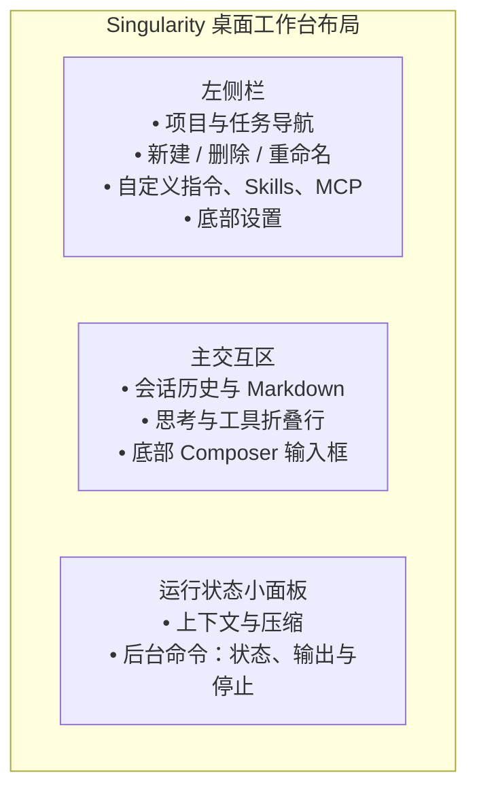

# 工作台交互

本文记录工作台各控件已经确认的操作方式：键盘、焦点、草稿、浮层位置和出错时的显示。改界面前先对照这里，改完同步更新。

界面导航、面板、设置、模型与工具名称统一使用 `--font-sans`，普通控件使用 400 常规字重；页面与弹窗标题保留标题层级，消息正文保留 Markdown 加粗，回复里的 Markdown 标题与正文同字号、只加粗。工具展开内容（read、bash 和后台命令）与工具摘要共用界面字体和字号，保留空格、缩进与换行；Markdown 代码和文件编辑区沿用等宽字体。消息字号设置同时缩放正文、思考与工具卡片、代码与表格、时间和统计行。思考与工具消息的字号、单行高度和正文气泡一致，折叠宽度随内容，展开仍按原卡片宽度显示；时间和统计保留较小字号。

## 发送与阅读

在开头或空白后输入 `/` 搜索可用 Skills。选择或手动输入的 `/技能名` 在发送前加载全文，同一消息重复引用只加载一次；输入框和用户气泡保持原文。技能读取失败时保留草稿并显示发送错误。

空闲时发送消息开始新的一轮；运行中发送的消息排队，在下一次模型请求前交给模型。刷新或关闭窗口不会停止正在运行的任务。

首次发送使用点击发送时选定的项目和模型。空白页从默认模型开始选择，创建后的任务保存自己的选择，修改默认值不切换已有任务的模型。项目列表读取期间或读取失败时，发送按钮同步禁用并显示原因。发送失败保留草稿；成功后只清理发送后没有再编辑的内容。等待期间可以切换页面，发送完成后停留在用户当前所在的页面。

首次读取旧草稿失败时，输入框留空，仍可输入文字、添加附件和发送消息，不显示提示。新输入照常保存，允许覆盖当前任务的旧草稿。

草稿自动保存或清理失败时不弹提示；当前输入继续保留在窗口内，发送和已完成的删除操作照常生效。

打开任务时读取完整历史，并按条目和偏移恢复上次的阅读位置。消息一经接受就可以停止任务，准备、执行和收尾阶段都显示停止按钮。回复达到输出上限时保留正文并显示未完成的原因，重新打开任务仍能看到。思考档位直接显示提供方使用的名称，模型编辑页只提供当前配置可用的档位或开关；已有无效选项保留并提示修正。

自动重试期间保持运行状态和停止按钮，不单独显示重试提示；重试规则见[架构说明](architecture.md#模型请求)。

回复完成时，正文、思考和工具按实际保存顺序显示；工具等待时显示“等待执行”，开始和完成只更新原位置；停止后不再显示等待，重新打开任务后顺序相同。等模型回复时（首个 token 之前，或两步之间没有条目在输出或执行）显示三点“正在输入”气泡；收到首个 token 后才在内容上方显示时间行。

结果保存失败后，当前页面保留已收到的临时内容，结束运行状态并显示错误。重新打开任务只显示实际保存的历史。

删除任务会停止该任务，删除会话日志和附件，并清理草稿和阅读位置。当前任务被删除后回到同项目的空白页。

## 运行状态小面板

打开任务后，顶栏右侧的“⋯”胶囊控制运行状态面板显示和隐藏，开关状态保留。面板里的“上下文”和“后台命令”卡片分别展开。上下文圆环与百分比只出现在面板的压缩胶囊中，顶栏不重复显示；面板宽度固定为 264px。

上下文卡片标题右侧是从顶栏移入的“圆环＋百分比”胶囊，替代百分比横条；点击胶囊直接手动压缩，不另设“压缩”按钮。胶囊按圆环和百分比内容定宽，百分比靠右保留小边距。右缘固定，百分比淡出、左缘向右收成圆形，圆内转圈；成功后原位置画出对勾，约 1.2 秒后向左展开并恢复百分比。失败或没有可压缩的内容时恢复原状。标题左侧仍独立展开上下文详情，下方显示已用和容量 token。没有运行中的后台命令时不显示后台命令卡片。本次启动后任务还没跑过回合时，展开上下文卡片会按回合开始时的规则读取一次指令和工具（含连接 MCP），读取中显示“读取中…”，失败显示原因并可重试。随后直接列出本任务开着的模块胶囊，和新建任务页同一套外观但小一号：名称加 `∼` 开头的估算 token，悬停显示用途和包含的工具名，顺序与新建任务页一致。关掉的模块不列出；胶囊在这里只显示，点不动，也不能在这里改任务的设置。运行面板打开时在右侧占出一列，消息区和输入框让开，不被面板盖住；窗口窄于 760px 时面板仍浮在消息上。切换任务时跟着切换。后台命令面板只列正在运行的命令，标题右侧只显示数量。每条复用消息区工具块的底色、边框和折叠样式：左侧转圈是停止按钮，悬停时只有圈变红，点击停止对应进程，停止请求期间禁用，失败后保留错误并可再次点击重试；后面显示实际命令，点击命令行在原面板内展开输出，面板宽度和占位不变；日志沿用消息区工具摘要的界面字体与字号，长行横向滚动。命令结束或停止后移出面板，历史信息仍在消息区查看。长标题和详情在面板内换行，面板只纵向滚动。

有弹窗、浮层或输入候选时，Escape 先关闭当前这一层；否则关闭运行小面板，焦点返回顶栏“⋯”胶囊。各卡片通过标题独立折叠。

## 管理页

侧栏是浅灰底，顶部依次提供新建任务、自定义指令、Skills、MCP，底部是设置；这些入口只有文字、不带图标，没有外框和分隔线。选中项用助手调色盘颜色的浅底，字色同色加深、字重保持常规（助手选默认白色时用主题强调色），悬停和按下只改变底色，不缩放。会话未选中时保持侧栏底色，选中底块使用助手调色盘颜色的浅底（默认白色时用主题强调色）。切换任务时，选中底块滑到新任务，任务名不加粗；任务列表重排时，底块跟随选中任务的位置。打开管理页后，再点任务回到会话。管理页内容限宽居中，滚动条位于主界面右边缘并保留占位，进入页面或加载内容时不横向跳动。项目名前有细线文件夹图标（展开时为打开的文件夹），会话缩进到与项目名文字左对齐，状态圆点放在会话行左侧的缩进里，与项目文件夹图标居中对齐。任务行不显示三个点按钮，右键或聚焦后按 Shift+F10 打开重命名、删除菜单，悬停时仍显示时间。

自定义指令页左侧像侧栏一样列出“全局指令”和各个项目：纯文字、无边框，选中项用助手调色盘颜色的浅底（默认白色时用主题强调色），悬停时显示浅灰底；切换只在原位变化底色并有按压反馈，选中底块不在选项之间滑动。右侧在细边框编辑区直接编辑 Markdown 原文，使用界面字体、15.5px 字号、1.85 倍行距和 20px 内边距；编辑区随窗口高度撑满剩余空间，顶部显示文件路径，底部只有保存按钮。切换目标时内容淡入，未保存草稿在目标之间切换时保留。保存成功后在窗口顶部居中弹出带绿色圆圈勾的“保存成功”胶囊，约 2.4 秒后消失；保存失败保留草稿并显示错误，不弹成功提示。保存后下一轮开始时读取。

Skills 按当前项目列出，没有选中项目时取第一个项目。标题右侧显示当前列表总数和刷新按钮；刷新重新扫描项目 `.singularity/skills/`、项目 `.agents/skills/`、应用主目录 `skills/` 和用户 `~/.agents/skills/`，按优先级合并可用技能，期间保留列表和总数，刷新入口为固定大小的圆形箭头图标，读取中只旋转图标，不切换文字、不缩放或变淡，完成后停在当前位置；读取期间不可重复触发。失败显示原因并保留原列表，可再次刷新；切换项目重新读取，不沿用其他项目的列表。列表不分全局和项目，是一整块细边框列表，行间细线分隔，各行等高，不显示图标；名称和描述各占一行，超出均省略；描述用浅灰小一号的字，短描述保留相同高度。整项可点击，在右侧文件栏查看完整 SKILL.md。

右侧文件栏查看只读文件，每个文件一个标签页：点标签切换，点 × 或鼠标中键关闭，关掉最后一个后整栏收起。从 Skills 页点开技能，或点回复里像文件路径的行内代码（如 `src/app.tsx`、`docs/x.md:12`，相对路径按任务的工作目录解析）都会在这里打开，同一文件的相对路径、绝对路径和不同斜杠写法共用一个标签；切到标签或再次点开同一文件时重新读取，显示文件当前的内容，读取期间保留旧内容。Markdown 默认排版显示，开头的 YAML 头显示成代码块，工具栏可切到源码；其他文件按扩展名高亮并带行号，超过 200 KB 不高亮。第一次读取时显示“读取中…”，文件不存在、超过 2 MB、不是 UTF-8 文本时显示原因并可重试。栏宽默认 480px，拖动左边缘或用方向键调整并记住；窗口窄于 760px 时浮在右侧。

MCP 管理页提供列表、编辑、删除和重试连接，读写方式与模型执行共用的 MCP 配置一致；已连接的服务器显示工具数和估算 token。这里没有启停开关，某个任务要不要用哪个服务器由新建任务页的胶囊决定。

## 输入区与时间线

输入区固定在窗口底部，实色卡片浮在消息上：细边框和很轻的投影，聚焦时边框略深。左侧加号直接打开附件选择；引用 Skill 直接在输入框输入 `/`。用户消息与编辑区保持相同顺序：图片和文件附件在上，文字在下，重新打开历史也一致。附件可以选择、拖入或粘贴：图片作为图片附件发送；其他文件在输入框和用户气泡里显示为文件卡片，只把绝对路径交给模型，由模型用 read 读取，文件本身不复制；粘贴的内存文件没有路径，只能作为图片使用。新任务页的输入框上方是一排胶囊，最上面是项目选择：点开向上展开菜单，当前项目带勾，末项是“添加项目”。下面按“指令 / 工具 / 技能 / MCP”分组列出这个任务会注入的内容，每个胶囊是名称加 `∼` 开头的估算 token，底部一行是合计（如 `∼ 20.7k tokens`）。系统提示词、`bash`、`task_*` 锁定，圆点是实心、点不动；其余点圆圈开关，关掉后名字和数字变淡、合计随之减少。胶囊只决定接下来这个任务的内容，随草稿保存，发送后和草稿一起清空，下次新建任务重新全开；读取中显示“正在读取上下文…”，失败显示原因并可重试。首次发送时确定所属项目和模型。Skill 候选每项只有一行，名字最多占 190px（界面字体，不用等宽字），说明在下一列用浅灰字，超长时省略；当前项用强调色浅底；鼠标移动到候选行时高亮跟随，方向键可继续切换，Enter 或 Tab 插入当前高亮项，点击直接插入该行。

新任务页只在选定项目且连接就绪后读取上下文；未选项目时不显示加载提示。小窗口中项目选择器和输入框保持可见，模块胶囊在中间独立滚动；项目菜单优先向上展开，空间不足时向下展开。

水球显示上下文占用，压缩时翻滚。运行中输入为空时点击停止，有草稿时点击发送并排队。等待回答时不能发送新消息，水球显示为停止。发送、禁用和停止仍使用原有条件。

切换任务时整页消息一起淡入（约 0.2 秒），不逐条弹出；任务里新出现的消息才逐条从下方弹出。用户和助手气泡采用相同内边距、圆角、字号和行高。用户气泡默认蓝底，最大宽度 72%；助手气泡默认白底细边框，最大宽度 88%。在我的气泡或助手气泡上右键，指针旁以消息出现的动画弹出调色盘：9 个玻璃球从中心依次弹到一圈上（灰黑、红、橙、黄、绿、青、蓝、紫、粉），当前颜色带蓝色外圈。点一个球后其他球淡出，选中的球像水滴一样落到右键的位置，落下时泛起一圈涟漪、气泡渐变成新颜色，然后调色盘关闭；系统开启减少动态效果时直接变色。我的气泡用实色（蓝色就是默认的主题蓝）；助手气泡用同色浅底，助手调色盘里灰黑那一格画成和其他球同风格的珍珠白球、名为“白色（默认）”，选它回到白底细边框。助手调色盘同时控制界面主题强调色，顶部导航、会话和指令选中状态、按钮与焦点色同步变化；未选中区域保持页面底色，选白色恢复浅色主题原蓝色、深色主题原粉色。用户气泡颜色独立。选中后同一方所有气泡一起变色（助手一方包括思考和工具卡片），保存在本机界面偏好里，失败气泡不响应。调色盘没有底板，只有一圈柔和淡彩的玻璃球：浅色的水装满，同色细边，左上一点高光。项目在输入框的项目选择器里只显示名称，没有图标。侧栏项目行高 34px，文件夹图标、名称和箭头垂直居中，图标距行左侧 10px。思考、工具、压缩和停止都显示成整块卡片，底色和边框跟助手气泡一致（随调色盘一起变），悬停时略微加深；思考、工具和压缩卡片用同一种展开方式：标题行不动，正文在下方平滑展开和收起；思考和压缩块展开后，点击正文区域也可收起，不必滚回标题；拖选文字或操作正文中的链接、复制按钮等控件不触发收起，其他块保持原有操作。同一回合内连续两个及以上同名工具调用默认合成折叠组，标题按“状态图标、工具名、各状态次数”排列，状态图标优先显示运行中，其次失败或中断，再次完成，和单条工具块保持左侧位置一致；点击组标题展开原始调用列表，再点收起，每条调用仍可独立展开详情。分组不跨越正文、思考或回合边界，交互提问始终独立显示，后台命令计数跟随最新状态。同一回合内相邻思考合成一个展示块，内容按顺序分段连接，不跨越正文、工具或回合边界。思考、工具、分组与压缩标题行最小高度 30px、行高随字号，图标和文字垂直居中；运行转圈与完成状态均使用同尺寸的图标库 SVG。思考图标沿用工具状态：运行中转圈、完成打勾、失败或中断显示对应图标。思考展开时标题行的摘要淡出，避免同一句话出现两次。思考进行中卡片固定为展开宽度，单行显示最新文字，新字从右侧进入、旧字在左侧淡出。命令与输出使用浅灰展示区，提供复制，长输出在区内滚动。回复里语言为 `mermaid` 的代码块在回复完成后画成图（生成中先显示代码，语法无法解析时保留代码）。图直接画在气泡里，节点为圆角浅色块配加粗深色字，每张图按内容固定取粉、蓝、绿、琥珀、紫中的一组；代码里用 `style`/`classDef` 写了颜色的节点保留自己的颜色。右上角是 ⋯ 菜单（复制代码、查看/隐藏代码，查看时原代码块显示在图下方）和放大按钮。图按气泡宽度缩放，最多缩到原尺寸的 60%，再宽在图内横向滚动。点图、按放大按钮或聚焦后按 Enter/空格打开居中的查看层：宽度随窗口、高度随图，最高 760px；滚轮以指针为中心缩放，拖动平移，Esc、关闭按钮或不拖动地点空白处关闭，点击图中节点保持打开。mermaid 只在第一次遇到图时加载。后台 bash 卡片根据 taskId 跟随后台命令：状态、输出、耗时和失败原因都以后台命令的最新记录为准，命令结束或重新打开任务后展开仍能看到完整输出。失败回复显示红色气泡。

用户消息上方显示发送时间，当天为 HH:mm，其他日期为 M/D HH:mm。每轮助手内容上方显示首 token 时间和本轮耗时，运行中每秒更新，结束后固定。手动停止显示“已停止”，其他中断显示“已中断”，两者使用相同圆圈叉号卡片，上方间距与思考、工具块一致为 10px。停止、中断或回合失败的状态块下方显示已记录的回合结束时间；异常退出未留下结束记录时不补造时间。每条回复下方显示截至这条回复时整个会话的累计统计，只写数值，如“TTFT 6.7s · 178 tok/s · 24.6K tokens · 91% · 21:52”，依次是平均首 token 时间、平均生成速度、总 token、缓存命中率（向下取整，全部命中才是 100%）和这条回复的完成时间，悬停时说明各项含义；越往后的回复数字随会话累计变化，缺失项直接省略。

执行中贴底时用约 90ms 的时间常数平滑跟随新内容，静止历史的图表排版完成时直接保持贴底；滚轮、触摸和按下立即停止。标题或正文实际触发展开、收起时，先保存同一阅读锚点并暂停贴底约 400ms，再判断是否仍在底部；选字和正文内部控件不触发这一步。任务阅读位置仍按条目和偏移保存、恢复。侧栏时间取最近一次执行记录，修改模型设置或任务名称不刷新时间。流式新增文字用 0.42 秒淡入。

## 交互提问面板（`ask_user_question`）

模型调用交互提问工具后，时间线里这次调用的工具卡片换成一个助手气泡，在气泡里作答；回答后恢复成“询问用户”工具卡片，展开可看到回答。输入框保持原样：
- **分页展示**：多题问答一次展示一道题，底部支持向前/向后切换；单题不显示页码和翻页按钮；
- **作答类型**：支持单选、多选及自由文本填写；
- **提交控制**：答完后一次提交给等待中的工具调用，可以跳过单个问题。气泡只负责作答，停止整个任务仍用输入区右下角的停止按钮。
- **切换任务**：未提交的答案和当前题号保留在当前工作台内存中；切回任务可继续填写。提交成功或问题结束后清理，刷新或退出应用后不保留。

## 设置

API Key 只能写入，界面只显示是否已配置。设置从侧栏底部打开，是一页可滚动的弹窗：上面“外观”一组（主题用浅色/深色分段切换，深色下卡片、弹窗、输入框、侧栏和半透明玻璃都换成深色底，颜色取自 tokens.css 的主题变量；消息字号），下面“模型”一组列出提供方，每行点开在原位置编辑，最后一行“添加提供方”。各组是细边框的圆角块（浅色为白底），组内一行一项。设置弹窗中的输入框、复选框和下拉框沿用全局键盘焦点样式，按 Tab 切换时显示焦点位置。MCP 保存期间，表单字段、保存和取消均不可用；失败后恢复编辑并保留已填内容，成功后更新列表并关闭表单。开关和删除也直接更新列表；读取失败时可点击“重新读取”。打开 MCP 管理页只查看已有状态，不主动建立连接；连接失败时可点击“重试连接”。

MCP 启动参数每行一个；空白行忽略，有内容的行保留原有空格。

“获取可用模型”只列出和添加模型 ID，已添加的模型不重复导入。上下文窗口、最大输出 Token 和思考选项在模型编辑弹窗中手动填写。取消或收起提供方编辑器、关闭设置后，尚未返回的模型列表查询结果不再打开模型选择列表。

## 弹窗与浮层

按钮、菜单、选择器、档位名和导航文字不参与拖选；消息正文、思考与压缩正文、代码和文件内容、文件路径、错误详情及输入编辑区仍可选字复制。

模态弹窗使用原生 `dialog.showModal()`，由 Chromium 管理层叠、背景不可操作、Tab 焦点范围和关闭后的焦点。Escape 或点击遮罩关闭最上层弹窗；弹窗内部菜单仍独立响应 Escape。

任务菜单、模型选择、协议选择和气泡调色盘使用原生 Popover 管理展开、点击外部关闭与按 Escape 返回焦点。按 Tab 可移到浮层外的下一个控件，列表内支持方向键、Home 和 End 选择。点击菜单项会先关闭浮层再打开对应对话框；选择模型后仍可继续调整思考档位。思考程度滑块顶部居中显示当前档位名；轨道里的已选部分按档位在全部档位中的位置着色（最低青、偏低蓝、偏高粉、最高紫色渐变），档位名同色。白色滑块嵌在轨道里，拖动时与鼠标 1:1 移动并保持按住的位置，松手后用弹簧吸附到档位。已选部分里的小白点从滑块后面冒出、向左飘走淡出，像向右冲刺的尾气，档位越高越密越快。浮层位置跟随触发按钮：模型浮层固定 240px 宽，向上展开，间距 8px，打开时水平中心对准按钮中心；打开期间切换模型、按钮变宽变窄，浮层不移动；其他浮层向下、靠左对齐，间距 6px，下方空间不足时向上展开，距窗口边缘至少留出 8px。协议浮层与按钮等宽。

## 动效

气泡入场、按压和浮层使用柔和 pop 弹簧，阻尼比 1、响应 0.38 秒；折叠与侧栏使用 smooth 弹簧。系统开启“减少动态效果”时，所有过渡立即完成。配色和动效时长以样式文件为准。

## 精确编辑工具

新建任务的工具模块包含可关闭的 `edit`，关闭时工具与用法说明一起移除。编辑保留现有工具消息块的标题、图标、路径摘要和折叠交互。成功后展开消息块，内部的差异卡片头显示文件名、绿色新增行数、红色删除行数及复制差异按钮。正文沿用工具消息字体与字号，显示语法高亮，删除行标原行号并用浅红底，新增行标新行号并用浅绿底，左侧色条标记改动；标题和上下文沿用消息块底色，不连续片段之间留白并用细线分隔。内容区最多高 360px，长行横向滚动。明暗主题与消息字号沿用工作台设置。失败沿用错误与参数卡片，重新打开任务显示已保存的相同差异。

项目选择菜单与触发按钮水平居中，优先向上展开，间隔 6px；菜单圆角 10px、轻阴影，内部留白 5px，选项高 32px、左右留白 10px。触发按钮、字体、配色和选择行为保持原样。
