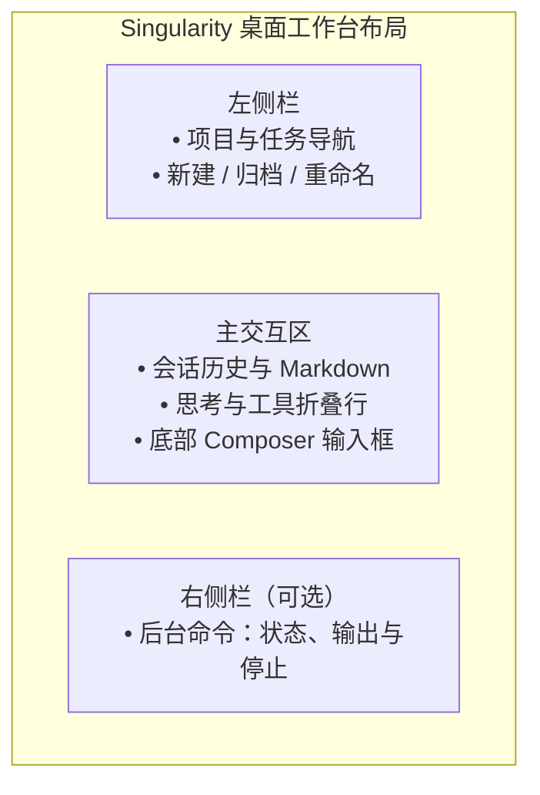

# 工作台交互指南

本文档介绍 Singularity 桌面工作台的界面布局、操作交互与视觉规范。

---

首次发送使用点击发送时选定的项目和模型。发送失败保留草稿；成功仅清理未被继续编辑的内容。等待期间可以切换页面，发送完成后停留在用户选择的页面。

## 6. 交互提问面板（`ask_user_question`）

当模型在执行中调用交互提问工具时，Composer 输入区自动切换为问答卡片：
- **分页展示**：多题问答一次展示一道题，底部支持向前/向后切换；单题不显示页码和翻页按钮；
- **作答类型**：支持单选、多选及自由文本填写；
- **提交控制**：作答完毕后统一提交给等待中的模型工具，支持单题跳过。问答卡片只负责作答，取消整次任务仍使用输入区右下角的统一停止按钮。
- **切换任务**：未提交的答案和当前题号保留在当前工作台内存中；切回任务可继续填写。提交成功或问题结束后清理，刷新或退出应用后不保留。

---

## 7. 视觉规范与动效约定

### 主题配色

| 类别 | 浅色主题 (Light) | 深色主题 (Dark) | 适用场景 |
| :--- | :--- | :--- | :--- |
| **画布背景** | `#ffffff` | `#191919` | 窗口底层底色 |
| **容器表面** | `#ffffff` | `#242424` | 侧栏、输入框、面板表面 |
| **强调色** | `#db2777` (Pink-600) | `#f472b6` (Pink-400) | 主按钮、选中态、连接与焦点 |
| **状态：成功** | `#34c759` | `#30d158` | 正常完成标识 |
| **状态：错误** | `#ff3b30` | `#ff453a` | 失败与中断提示 |

设置弹窗中的输入框、复选框和下拉框沿用全局键盘焦点样式；使用 Tab 切换时显示当前位置。MCP 保存及保存后的列表刷新期间，编辑字段、保存和取消均不可用；失败后恢复编辑并保留表单内容，成功后关闭表单。

### 关键过渡动效

- **侧栏开合**：280ms 缓入缓出过渡；
- **折叠面板（Disclosure）**：展开 250ms，收起 200ms，带 2px 模糊消除与高度渐变；
- **工具栏加号变形（Morph）**：从圆按钮平滑过渡至弹出菜单，展开 350ms，收起 250ms；
- **浮层动画**：缩放 + 位移 + 淡入（展开 250ms，收起 200ms）；
- **系统减少动态效果（prefers-reduced-motion）**：开启时所有过渡时间归零，立即切换。
